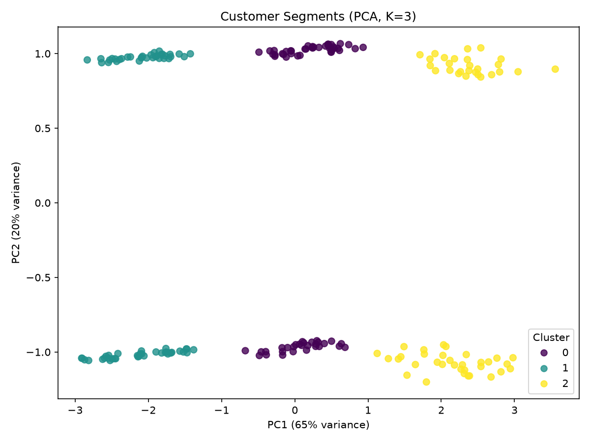
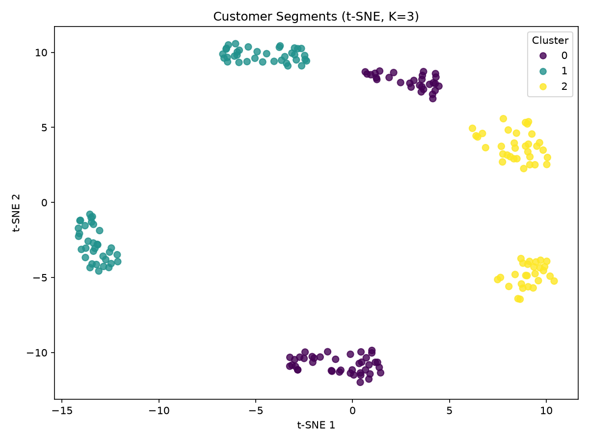

# Customer Segmentation using K-Means

Customer segmentation using K-Means clustering on a synthetic customer dataset, with preprocessing, validation, evaluation, visualization, hyperparameter tuning, an interactive Streamlit dashboard, tests and performance benchmarks.

- **Live Demo:** [Customer Segmentation Dashboard](https://customer-segmentation-thatchaa.streamlit.app)
- **Demo Video:** [Watch the demo video](https://drive.google.com/file/d/1P8VIy4MtSZFEwbLec5ZHyJRGHkUs0oZZ/view?usp=sharing)

## Table of Contents

1. [How to Run](#how-to-run)
2. [Project Structure](#project-structure)
3. [K-Means Algorithm Summary](#k-means-algorithm-summary)
4. [Data Sources](#data-sources)
5. [Preprocessing Steps](#preprocessing-steps)
6. [Input Validation](#input-validation)
7. [Implementation Details](#implementation-details)
8. [Results](#results)
9. [Evaluation Metrics](#evaluation-metrics)
10. [Visualization](#visualization)
11. [Interactive Dashboard](#interactive-dashboard)
12. [Hyperparameter Tuning](#hyperparameter-tuning)
13. [Advanced Features](#advanced-features)
14. [Optimization Techniques](#optimization-techniques)
15. [Logging and Monitoring](#logging-and-monitoring)
16. [Testing](#testing)
17. [Performance Testing](#performance-testing)
18. [User Testing](#user-testing)

## How to Run

1. Clone the repository:

   ```
   git clone https://github.com/Thatchaayini/customer-segmentation-kmeans.git
   cd customer-segmentation-kmeans
   ```

2. (Optional) Create and activate a virtual environment:

   ```
   python -m venv venv
   venv\Scripts\activate
   ```

   On macOS / Linux use `source venv/bin/activate` instead of the second line.

3. Install packages:

   ```
   pip install -r requirements.txt
   ```

4. Run the full pipeline (generates the data if needed, preprocesses, validates, clusters and saves the result):

   ```
   python main.py
   ```

5. Run the other tools as needed:

| Command | What it does |
|---|---|
| `python evaluation.py` | Compares K = 2 to 8 with clustering metrics |
| `python visualization.py` | Saves PCA and t-SNE plots to `images/` |
| `python tuning.py` | Grid search over K-Means parameters |
| `python advanced_clustering.py` | Hierarchical clustering and DBSCAN |
| `python benchmark.py` | Performance benchmark on growing datasets |
| `streamlit run dashboard.py` | Launches the interactive dashboard |
| `pytest -v` | Runs all tests |
| `ruff check .` | Checks code style |

## Project Structure

| File | Purpose |
|---|---|
| `generate_data.py` | Generates the synthetic customer dataset |
| `preprocess.py` | Cleans, encodes and scales the data |
| `validate.py` | Validates inputs before K-Means |
| `segmentation.py` | K-Means clustering with edge case handling |
| `main.py` | Runs the full pipeline end to end |
| `evaluation.py` | Evaluation metrics for K = 2 to 8 |
| `visualization.py` | PCA and t-SNE plots |
| `dashboard.py` | Interactive Streamlit dashboard |
| `tuning.py` | Hyperparameter grid search |
| `fast_tuning.py` | Parallel and cached tuning |
| `advanced_clustering.py` | Hierarchical clustering and DBSCAN |
| `benchmark.py` | Performance benchmark |
| `config.py` | Shared configuration (random state, paths, features, logging) |
| `logger.py` | Logging helpers and the `@timed_step` decorator |
| `test_*.py` | Pytest test files (see [Testing](#testing)) |
| `FEEDBACK.md` | Self-testing notes and fixes |

## K-Means Algorithm Summary

K-Means is an unsupervised machine learning algorithm that groups data into K clusters based on similarity.

**How it works:**

1. Choose the number of clusters (K).
2. Initialize K centroids (k-means++ is used to pick well-spread starting points).
3. Assign each data point to its nearest centroid.
4. Recalculate each centroid as the mean of its assigned points.
5. Repeat steps 3 and 4 until convergence (centroids stop moving significantly or the maximum iterations are reached).

**Use in this project:** Customers are segmented using features like Annual Income, Purchase Frequency and Average Order Value. The Elbow method helps choose the best K.

## Data Sources

The dataset (`data/customers.csv`) is a synthetic customer dataset of 200 records generated by `generate_data.py` (fixed random seed, so it is reproducible). It simulates three customer groups.

| Feature | Type | Description |
|---|---|---|
| CustomerID | int | Unique customer ID |
| Age | int | Customer age (demographic) |
| Gender | str | Male / Female (demographic) |
| AnnualIncome | int | Annual income in thousand dollars |
| PurchaseFrequency | int | Number of purchases per year |
| AvgOrderValue | float | Average order value in dollars |

## Preprocessing Steps

Implemented in `preprocess.py`:

1. **Load data** from `data/customers.csv`.
2. **Clean data:** remove duplicate rows and rows with missing values.
3. **Encode categorical data:** Gender is mapped to numbers (Male = 0, Female = 1).
4. **Normalize features:** all 5 features are scaled with `StandardScaler` (mean = 0, standard deviation = 1), so no feature dominates the distance calculation in K-Means.

## Input Validation

Implemented in `validate.py`. Before clustering, it checks for required columns, missing values, non-numeric and infinite values, negative values, enough rows for K clusters, and correct scaling (mean about 0, std about 1).

## Implementation Details

The workflow in `main.py` runs these steps:

1. Generate the dataset if `data/customers.csv` does not exist.
2. Preprocess: remove duplicates and missing values, encode Gender, scale features with StandardScaler.
3. Validate the data (columns, missing, infinite and negative values, enough rows, correct scaling).
4. Run K-Means (k-means++ initialization, `n_init=10`, fixed `random_state=42` for reproducible results).
5. Save the segmented customers to `data/customers_segmented.csv`.

**Edge cases handled in `segmentation.py`:**

- Empty data raises a clear error.
- Invalid K (less than 1) raises an error.
- K larger than the number of rows or distinct points is reduced automatically.
- If any cluster ends up empty, K is reduced and the model is retrained.

## Results

With K = 3, the customers split into three segments:

| Cluster | Profile | Size |
|---|---|---|
| 0 | Medium income, medium spending | 70 |
| 1 | Young, low income, very frequent purchases | 70 |
| 2 | High income, rare purchases, high order value | 60 |

## Evaluation Metrics

Implemented in `evaluation.py`. For K = 2 to 8, K-Means is evaluated with:

- **Silhouette score** (higher is better, range -1 to 1)
- **Calinski-Harabasz index** (higher is better)
- **Davies-Bouldin index** (lower is better)
- **Inertia** (used for the Elbow method)

Run it with `python evaluation.py`.

**Findings:** Both silhouette (0.50) and Calinski-Harabasz (230.88) are highest at K = 6, although the data was generated with 3 customer groups. The extra clusters appear because the random Gender feature splits each group into two. K = 3 scores lower (silhouette 0.39) but gives the most meaningful business segments.

## Visualization

Implemented in `visualization.py`. The 5 scaled features are reduced to 2 dimensions so the customer segments can be plotted:

- **PCA** (`images/pca_clusters.png`): the first two components explain about 85% of the variance (PC1 = 64.7%, PC2 = 20.1%).
- **t-SNE** (`images/tsne_clusters.png`): shows the local structure of the data.

Run it with `python visualization.py`.

**Findings:** The t-SNE chart shows six compact blobs, two for each K-Means cluster. This is because the random Gender feature splits every customer group into two, which also explains why the metrics favor K = 6.




## Interactive Dashboard

Implemented in `dashboard.py` with Streamlit and Plotly. Try it online at the [live dashboard](https://customer-segmentation-thatchaa.streamlit.app), or run it locally:

```
streamlit run dashboard.py
```

Features:

- Slider to choose the number of clusters (K) and see the metrics update live
- Switch between PCA and t-SNE projections
- Hover over any point to see customer details
- Filter which clusters are shown
- Compare any feature across clusters with a box plot
- Metric tooltips
- Cluster profile table and CSV download of the segmented data

## Hyperparameter Tuning

Implemented in `tuning.py`. A grid search tries every combination of these K-Means parameters and ranks them by silhouette score:

| Parameter | Values tried |
|---|---|
| `n_clusters` | 2 to 8 |
| `init` | k-means++, random |
| `n_init` | 5, 10, 20 |
| `max_iter` | 100, 300 |

84 combinations are evaluated (silhouette, Calinski-Harabasz, Davies-Bouldin, inertia). Full results are saved to `data/tuning_results.csv`. Run it with `python tuning.py`.

**Findings:** The best `n_clusters` is 6 (silhouette 0.502), which matches the evaluation metrics. The top 10 combinations have identical scores, so `init`, `n_init` and `max_iter` make no difference on this dataset. The clusters are well separated, so K-Means is stable and always reaches the same result. The number of clusters is the only parameter that matters here.

## Advanced Features

- **Hierarchical clustering and DBSCAN** (`advanced_clustering.py`): Ward-linkage hierarchical clustering, DBSCAN with noise detection, and a saved dendrogram (`images/dendrogram.png`).

## Optimization Techniques

- **Parallel tuning and caching** (`fast_tuning.py`): `joblib.Parallel` runs parameter combinations in parallel and `joblib.Memory` caches results on disk. On the 200-row dataset, a warm cache cut tuning time from 3.98s to 0.46s. Parallel processing alone did not help on this small dataset because process overhead dominates, but it should help on larger data.
- **Shared configuration** (`config.py`): random state, paths, feature columns and log settings are defined once instead of being hardcoded.

## Logging and Monitoring

- `logger.py` provides `get_logger` and the `@timed_step` decorator, which logs the start, finish time and any errors of a step to the console and `logs/segmentation.log`.

## Testing

All tests are written with pytest. Run them with:

```
pytest -v
```

52 tests currently pass. Code style is checked with `ruff check .`.

| Test file | What it covers |
|---|---|
| `test_segmentation.py` | K-Means clustering and edge cases (empty data, invalid K, empty clusters) |
| `test_pipeline.py` | End-to-end workflow and reproducibility |
| `test_evaluation.py` | Evaluation metrics and K range comparison |
| `test_visualization.py` | PCA, t-SNE and plot saving |
| `test_tuning.py` | Hyperparameter grid search |
| `test_metrics_and_plots.py` | Extra checks: good vs bad clustering scores, inertia trend, PCA reproducibility, image output |
| `test_benchmark.py` | Performance benchmark: dataset builder, stage timings, benchmark output |

## Performance Testing

Implemented in `benchmark.py`. It runs the full workflow (clean, encode, scale, validate, cluster, evaluate, PCA) on datasets of increasing size, built by resampling the base data with small random noise. It measures the time of every stage and the peak memory. Run it with `python benchmark.py`. Results are saved to `data/performance_results.csv`.

| Rows | Total time | Rows per second | Peak memory |
|---|---|---|---|
| 200 | 0.05 s | 4,108 | 0.7 MB |
| 1,000 | 0.09 s | 10,667 | 15 MB |
| 5,000 | 0.36 s | 13,829 | 382 MB |
| 10,000 | 1.33 s | 7,497 | 1,527 MB |

**Findings:**

- The full workflow handles 10,000 customers in about 1.3 seconds.
- K-Means itself is fast (0.08 s for 10,000 rows). Cleaning, encoding, scaling and validation each take a few milliseconds.
- The evaluation stage (silhouette score) is the bottleneck, over 90% of the total time for large data. Doubling the rows roughly quadruples its time, because the silhouette score compares every point with all other points. Memory also grows about four times when the rows double.
- Possible improvement for much larger data: compute the silhouette score on a random sample using the `sample_size` parameter.

## User Testing

- Self-testing notes and the fixes made are in `FEEDBACK.md`.

## Live Demo

[Customer Segmentation Dashboard](https://customer-segmentation-thatchaa.streamlit.app)

## Demo Video

[Watch the demo video](https://drive.google.com/file/d/1P8VIy4MtSZFEwbLec5ZHyJRGHkUs0oZZ/view?usp=sharing)